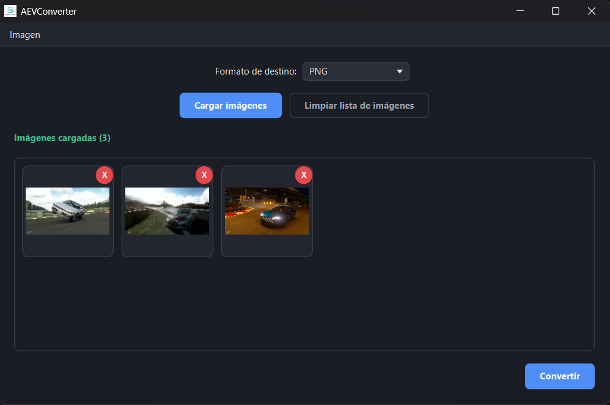
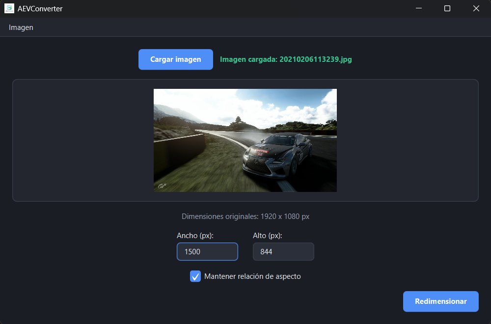

# AEVConverter
## Índice
- [Descripción](#descripción)
- [Funcionalidades](#funcionalidades)
- [Formatos soportados](#formatos-soportados)
- [Tecnologías utilizadas](#tecnologías-utilizadas)
- [Descarga](#descarga)

## Descripción
Programa para Windows o Linux para convertir archivos a distintos formatos y redimensionar imágenes. Hecho con JavaFX para tener una interfaz simple e intuitiva.

## Funcionalidades
- Convertir multiples imagenes a un formato diferente.

- Redimensionar imagenes manteniendo o no la relación de aspecto.

## Formatos soportados
Imágenes soportadas para convertir y redimensionar:
| Formato    | Conversión | Redimensionar |
|:----------:|:----------:|:-------------:|
| PNG        | ✅         | ✅            |
| JPG / JPEG | ✅         | ✅            |
| WEBP       | ✅         | ✅            |
| TIFF / TIF | ✅         | ✅            |
| ICO        | ✅         | ❌            |
| BMP        | ✅         | ✅            |
| TGA        | ✅         | ❌            |

## Tecnologías utilizadas
- Java 25
- JavaFX 27.0.1
- CSS
- Maven

## Descarga
Para descargar AEVConverter tienes que dirigirte a este enlace: [Página de lanzamientos](https://github.com/AaronEV-P/AEVConverter/releases).